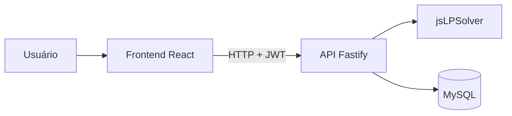

# SuínoNutri

O SuínoNutri é um sistema web que calcula a **ração de menor custo** para suínos de 30 a 60 kg, cumprindo as exigências nutricionais da fase. Ele resolve o problema por Programação Linear e também aceita qualquer outro problema linear, de minimização ou de maximização.

Trabalho final de **Aplicação Prática de Programação Linear** (2º semestre de 2026), da Faculdade de Tecnologia de Mococa – Mário Robertson de Sylos Filho (**Fatec Mococa**). Tema 3: ração de custo mínimo para suínos em crescimento (30 a 60 kg).

## O problema

Um produtor tem vários ingredientes (milho, farelo de soja, farelo de trigo, minerais etc.), cada um com um preço por kg e uma composição de nutrientes. A ração precisa ter uma quantidade mínima (e às vezes máxima) de proteína, energia, fósforo, cálcio e lisina. A pergunta é: **quanto de cada ingrediente usar em 1 kg de ração para gastar o mínimo possível?**

## Visão geral da solução

| Camada | Tecnologia | Papel |
| --- | --- | --- |
| Banco de dados | MySQL | Guarda usuários, ingredientes, restrições, problemas e resultados. |
| Backend | Node.js 22, Fastify, jsLPSolver | API REST com autenticação JWT; monta o modelo e chama o solver. |
| Frontend | React 19, Vite | Telas para cadastrar ingredientes e restrições, calcular e ver a receita. |
| Execução | Docker Compose | Um comando sobe o banco, as migrations e a API. |

## Como esta documentação está organizada

1. [Modelagem](./modelagem): o problema escrito em Programação Linear e o resultado do exemplo.
2. [Banco de dados](./banco-de-dados): tabelas e relacionamentos.
3. [Backend](./backend): arquitetura, rotas, solver e segurança.
4. [Frontend](./frontend): telas, guia e acessibilidade.
5. [Testes](./testes): o que foi testado e os resultados.
6. [Equipe](./equipe): quem fez cada parte.
