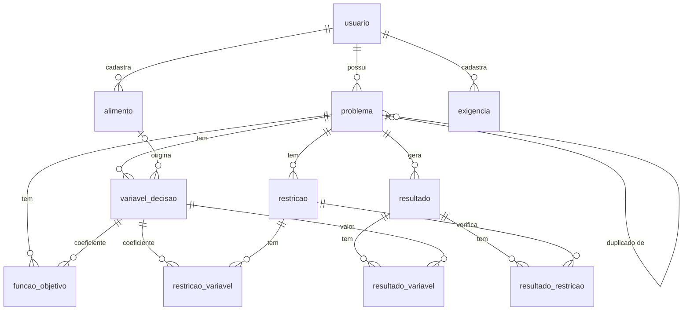

# Banco de dados

MySQL, banco `projeto_linear`. O script `database/init/01-projetolinear_bd.sql` cria as tabelas do modelo. As migrations em `migrations/` (executadas por `npm run migrate`) acrescentam usuários e a posse dos dados.

## Diagrama

## Tabelas

| Tabela | Para que serve | Origem |
| --- | --- | --- |
| `usuario` | Conta do usuário: nome, e-mail único e `senha_hash` (bcrypt). | migration 001 |
| `problema` | Uma formulação: nome, objetivo (`MIN` ou `MAX`), dono (`id_usuario`) e, se foi duplicada, o problema de origem. | base + 002 |
| `alimento` | Ingrediente com proteína, energia, fósforo, cálcio, lisina e `custo_kg`. Cada um pertence a um usuário. | base + 003 |
| `variavel_decisao` | Variável de um problema, ligada (ou não) a um alimento; pode ser inteira. | base |
| `funcao_objetivo` | Coeficiente de cada variável na função objetivo. | base |
| `restricao` | Restrição do problema: nome, sinal (`<=`, `>=`, `=`) e valor. | base |
| `restricao_variavel` | Coeficiente de cada variável em cada restrição. | base |
| `resultado` | Uma execução do solver: status (`PENDENTE`, `OTIMO`, `INVIAVEL`, `ILIMITADO`, `ERRO`), valor do objetivo e data. | base |
| `resultado_variavel` | Valor de cada variável em um resultado. | base |
| `resultado_restricao` | Valor calculado, folga e se foi atendida, para cada restrição. | base |
| `exigencia` | Restrição nutricional reutilizável do usuário (mínimo e/ou máximo de um nutriente, com teores por ingrediente). Única por usuário e nome. | migration 004 |

## Regras de exclusão

- Apagar um **problema** apaga em cascata suas variáveis, função objetivo, restrições e resultados.
- Apagar um **alimento** não apaga a variável que o usa: a ligação vira nula (`SET NULL`).
- Apagar um **problema de origem** não apaga as cópias: o vínculo vira nulo.
- Problemas e alimentos usam `ON DELETE RESTRICT` para o usuário; por isso, ao **excluir a conta**, a API apaga os problemas e alimentos do usuário e depois o usuário, na mesma transação. As exigências caem em cascata.

## Índice

`idx_resultado_problema_data (id_problema, data_calculo)` acelera a consulta do histórico de resultados de um problema.
