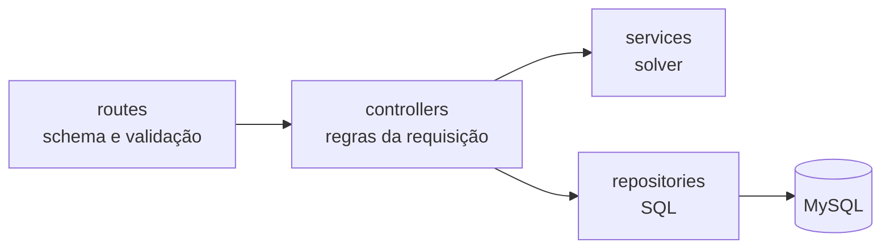

# Backend

API REST em **Node.js 22 (ES Modules)** com **Fastify 5**, **MySQL** (`mysql2`) e o solver **jsLPSolver**. A documentação interativa fica no Swagger/OpenAPI.

## Arquitetura em camadas



| Camada | Responsabilidade |
| --- | --- |
| `routes` | Declara as rotas, o schema de entrada e saída e a documentação Swagger. |
| `controllers` | Recebe a requisição, aplica as regras e escolhe o código HTTP. |
| `services` | `solverService` transforma o modelo para o jsLPSolver e interpreta o resultado. |
| `repositories` | Todo o acesso ao banco, com consultas parametrizadas. |
| `plugins` | Autenticação JWT reutilizável pelas rotas. |

## Rotas por categoria

O detalhe de cada rota (campos, exemplos e respostas) está no Swagger. Resumo:

| Categoria | O que faz |
| --- | --- |
| Autenticação | Cadastro, login, consulta e alteração de perfil, troca de senha e exclusão da conta. |
| Alimentos | Cadastro dos ingredientes do usuário. |
| Exigências | Restrições nutricionais reutilizáveis (mínimo e máximo por nutriente). |
| Problemas | Criação, listagem, duplicação e exclusão de formulações; `POST /problemas/completo` cria o problema inteiro em uma chamada. |
| Variáveis, Função objetivo e Restrições | Montagem passo a passo do modelo. |
| Resultados | `POST /problemas/:id/executar` roda o solver e grava o resultado; `GET /problemas/:id/resultados` lista o histórico. |

### Cadastro completo em uma chamada

`POST /problemas/completo` recebe o problema, as variáveis, a função objetivo e as restrições (relacionadas pelo **nome**) e grava tudo em **uma transação**: se qualquer parte for inválida, nada é gravado.

## Solver

O modelo do banco é convertido para o formato do jsLPSolver: `MIN`/`MAX` viram `min`/`max`, e os sinais `<=`, `>=` e `=` viram limites `max`, `min` e `equal`. Variáveis marcadas como inteiras são resolvidas como inteiras.

| Status | Significado |
| --- | --- |
| `OTIMO` | Solução ótima encontrada; grava valores das variáveis e a verificação de cada restrição. |
| `INVIAVEL` | Nenhuma solução atende todas as restrições. |
| `ILIMITADO` | A função objetivo melhora sem limite. |
| `ERRO` | Falha inesperada do solver. |

Para cada restrição o resultado traz `valor_calculado`, `folga` (sobra, excedente ou diferença) e `atendida`, com tolerância de 0,000001. Resultado e filhos são gravados na mesma transação.

## Segurança

| Controle | Como funciona |
| --- | --- |
| Autenticação | JWT HS256 válido por 8 horas; `JWT_SECRET` obrigatório, com no mínimo 32 caracteres. |
| Senhas | Hash bcrypt (custo 12), de 8 a 72 caracteres. O login leva o mesmo tempo com e-mail inexistente ou senha errada. |
| Dados por usuário (IDOR) | Toda consulta filtra por `id_usuario`; recurso de outro usuário responde 404. |
| Rate limit | Por IP: 300 requisições/min no geral, 10 logins/min, 10 cadastros/hora e 30 execuções do solver/min. |
| CORS e cabeçalhos | Só as origens permitidas; `@fastify/helmet`. |
| Contra abuso | Corpo máximo de 100 KB, timeouts de 30 s, solver limitado a 200 variáveis, 500 restrições e 10 s. |
| Entrada | Schemas descartam campos não previstos (`id_usuario` no corpo é ignorado). |
| Operações sensíveis | Trocar a senha e excluir a conta exigem a senha atual. |
| Docker | O contêiner roda como usuário `node`; as portas só abrem em `127.0.0.1`. |

## Como executar

Precisa de **Docker Desktop** e **Git**.

```bash
git clone https://github.com/luizfelipedev19/Programacao-Linear.git
cd Programacao-Linear
cp .env.example .env     # edite o JWT_SECRET (mínimo de 32 caracteres)
docker compose up --build
```

O Docker cria o MySQL, executa o script do banco, roda as migrations e inicia a API.

| O quê | URL |
| --- | --- |
| Swagger | http://localhost:3000/docs |
| Verificação da API e do banco | http://localhost:3000/health |
| Especificação OpenAPI | http://localhost:3000/docs/json |

No Swagger: execute `POST /auth/cadastro`, depois `POST /auth/login`, copie o `token`, clique em **Authorize** e cole só o token.
