# Frontend

Aplicação **React 19** com **Vite**, em `frontend/suinonutri-frontend`. Conversa com a API por JWT e foi pensada para ser **didática para qualquer pessoa, de qualquer idade**.

Para rodar: `npm install` e `npm run dev`, com a API ativa. O endereço padrão é http://localhost:5173.

## Telas

| Tela | O que o usuário faz |
| --- | --- |
| Login e Cadastro | Cria a conta e entra no sistema. |
| Dashboard | Vê o resumo: rações calculadas, economia, custo médio do kg, gráfico do custo e últimas rações. |
| Nova Otimização | Calcula a ração em 3 etapas: nome, ingredientes (mínimo 2) e exigências nutricionais (mínimo 1). |
| Ingredientes | Cadastra os ingredientes, com preço por kg e composição. |
| Restrições | Vê as 5 exigências padrão, edita os valores ou cria outras (por exemplo, fibra). |
| Histórico de otimizações | Lista todas as rações calculadas, com busca e filtro por situação. |
| Resultado | Vê o custo por kg, a quantidade de cada ingrediente (ou do lote que quer produzir) e se cada exigência foi cumprida. |
| Relatórios | Analisa para onde vai o dinheiro, o que mais encarece e compara duas rações; exporta em Excel ou PDF. |
| Configurações | Altera nome, e-mail e senha, abre as opções de acessibilidade, baixa os dados ou exclui a conta. |

## Capturas de tela

### Login e cadastro

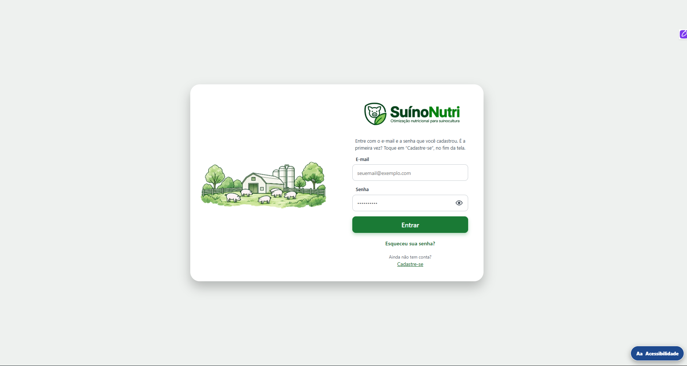

*Login: e-mail e senha, com o botão de mostrar a senha e o link para criar a conta.*

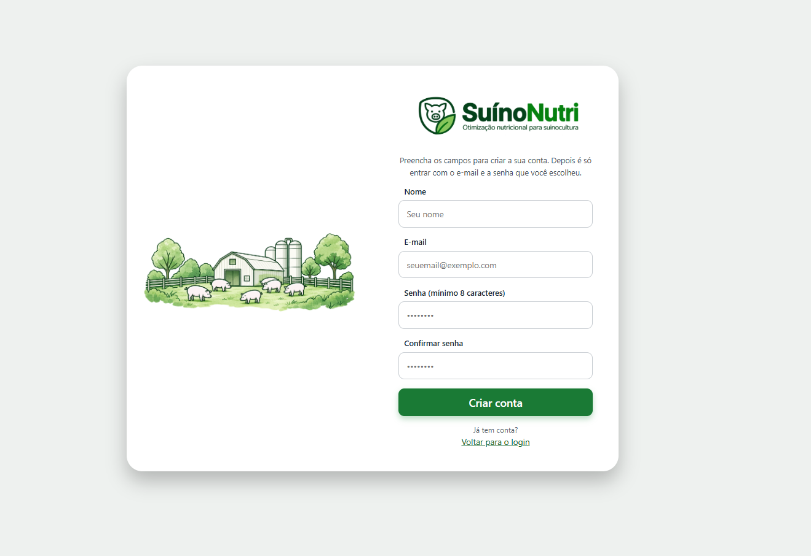

*Cadastro: nome, e-mail e senha (mínimo de 8 caracteres) com confirmação.*

### Boas-vindas e guia

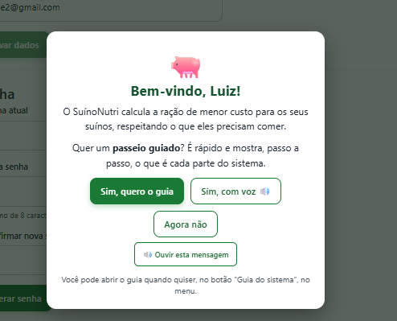

*Na primeira entrada, o sistema oferece um passeio guiado, com ou sem voz.*

### Dashboard

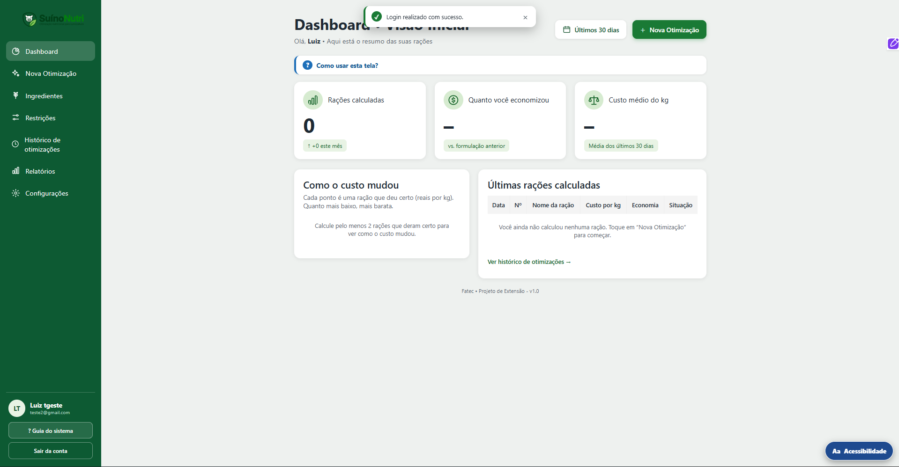

*Resumo da conta: rações calculadas, economia, custo médio do kg, gráfico do custo e as últimas rações.*

### Cadastros

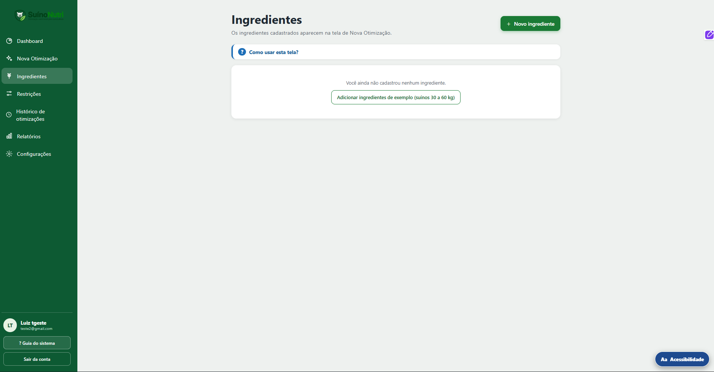

*Ingredientes: cadastro com preço por kg e composição. Para começar, há um botão que adiciona os ingredientes de exemplo.*

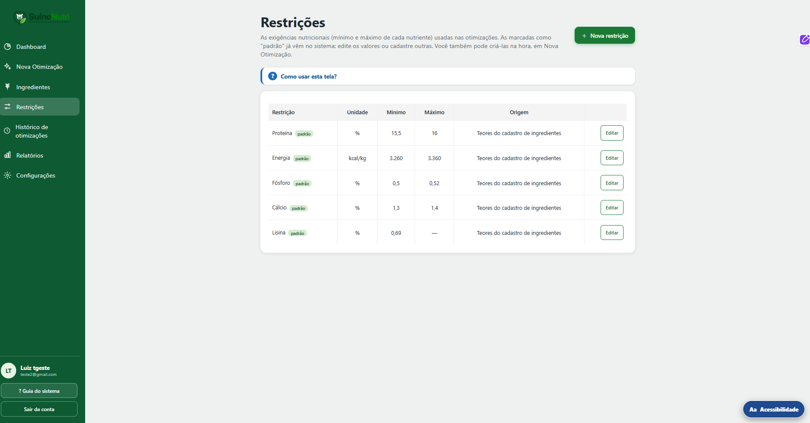

*Restrições: as 5 exigências nutricionais padrão (proteína, energia, fósforo, cálcio e lisina), com mínimo e máximo editáveis.*

### Otimização e histórico

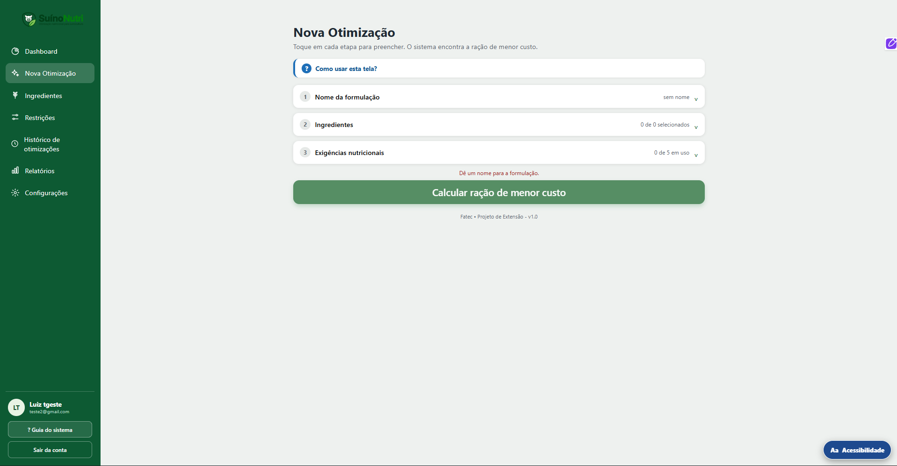

*Nova Otimização em 3 etapas: nome, ingredientes e exigências nutricionais. O botão de calcular só libera quando tudo está preenchido.*

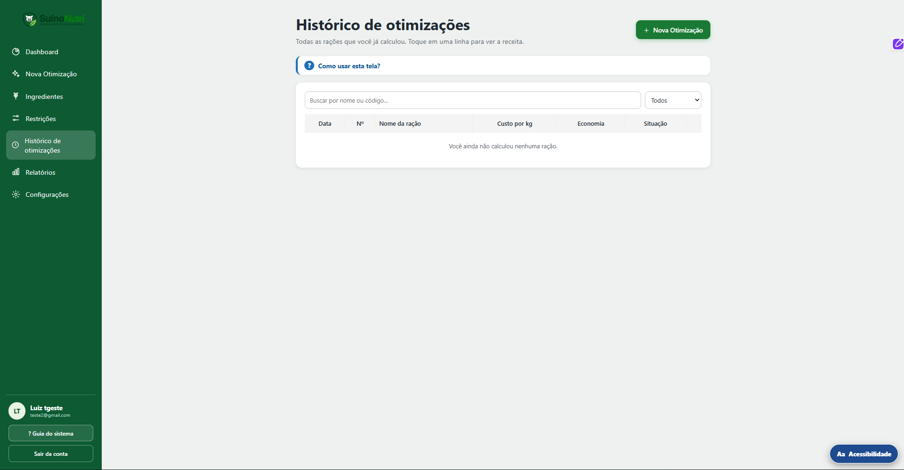

*Histórico: todas as rações calculadas, com busca por nome e filtro por situação.*

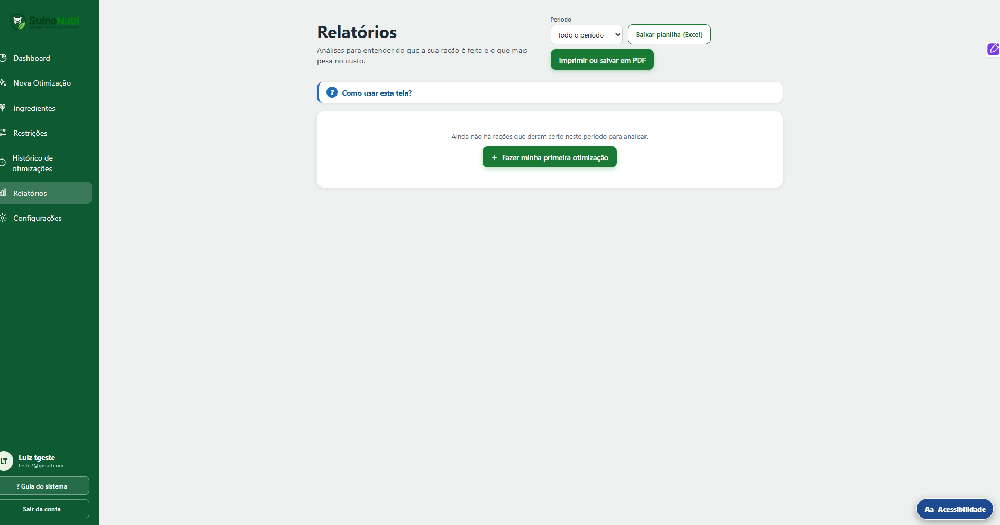

*Relatórios: análises das rações calculadas, com exportação em planilha (Excel) e PDF.*

### Conta e acessibilidade

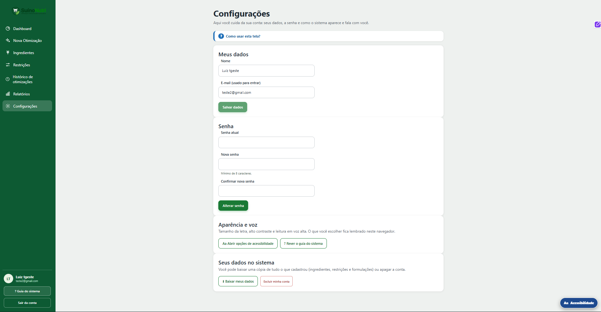

*Configurações: dados da conta, troca de senha, acessibilidade e exclusão da conta.*

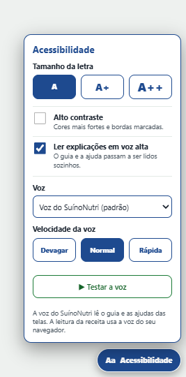

*Painel de acessibilidade: tamanho da letra, alto contraste e leitura em voz alta, com escolha da voz e da velocidade.*

## Fluxo de uso

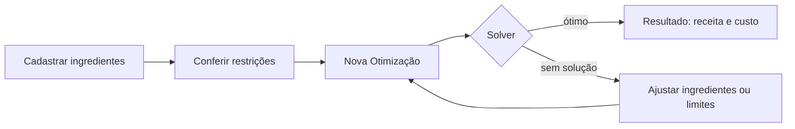

## Acessibilidade e ajuda

- **Guia do sistema:** na primeira entrada, uma boas-vindas oferece um passeio guiado de 14 passos, com a parte da tela destacada.
- **Ajuda em todas as telas:** um bloco "Como usar esta tela?" fechado por padrão, e botões "?" que explicam cada campo.
- **Painel Acessibilidade:** tamanho da letra (A, A+, A++), alto contraste e leitura em voz alta, com escolha da voz e da velocidade.
- **Voz:** o guia e as ajudas têm áudio gravado com a voz **Piper** (código aberto, gerada uma vez e guardada no projeto); a leitura da receita usa a voz do navegador.
- **Teclado e leitores de tela:** link "Pular para o conteúdo", marcos de página, foco no título a cada tela, setas e Esc no guia.
- **Verificação:** auditoria automática com axe-core, sem violações nos modos normal e alto contraste.
